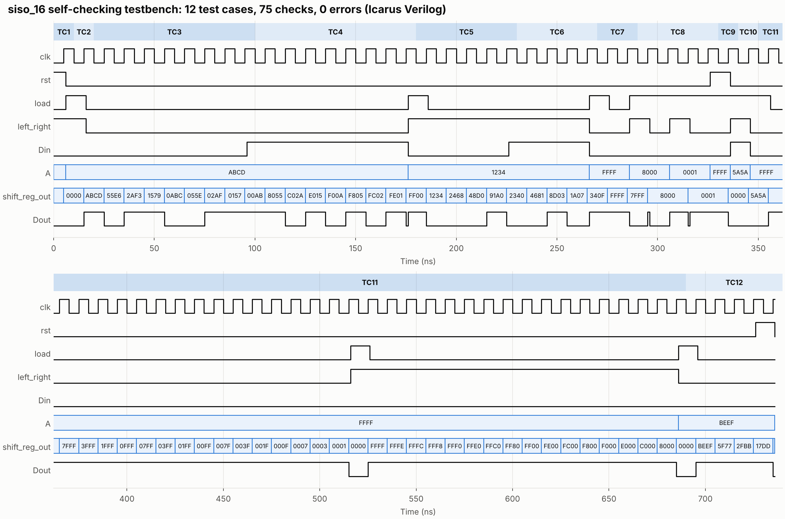
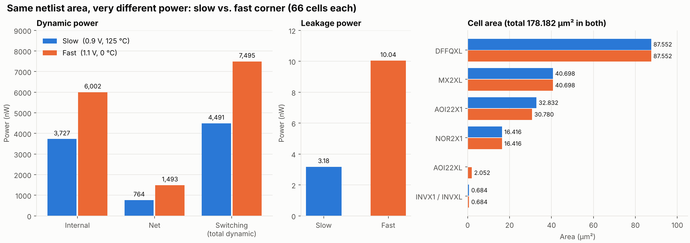
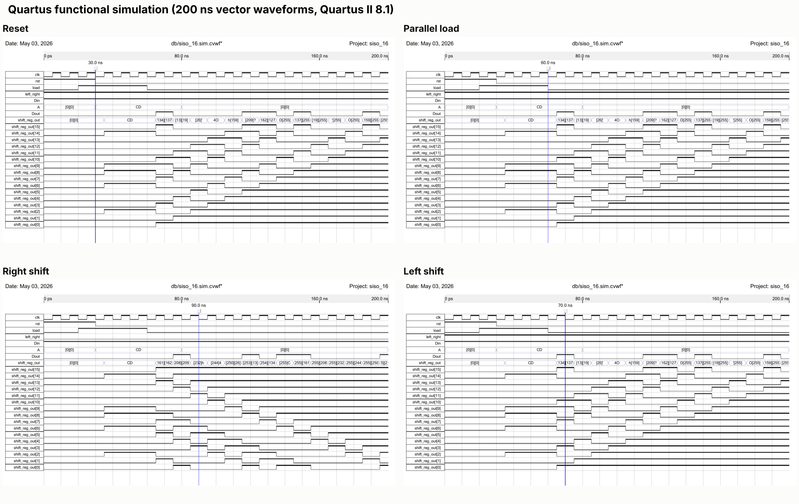
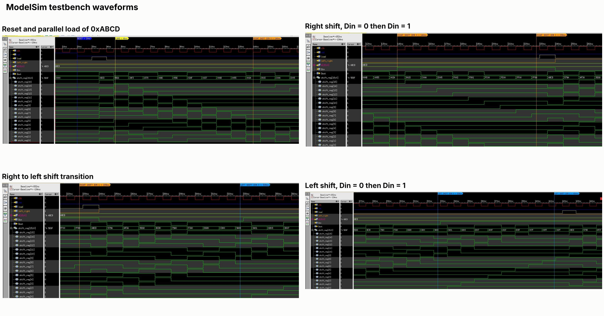
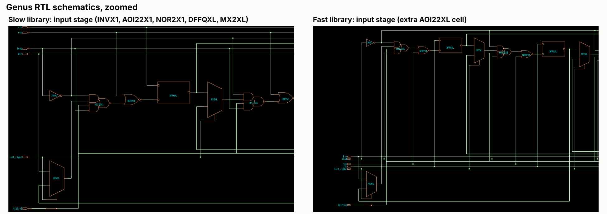
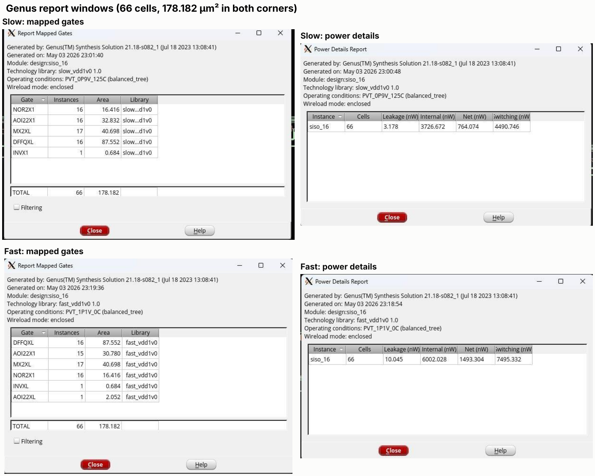

# BitConveyor

### Two corners, one conveyor of bits: a 16-bit bidirectional shift register, verified and synthesized at slow and fast process corners

A synchronous 16-bit serial-in serial-out (SISO) shift register with parallel load, written in Verilog and taken from RTL to gates. It is verified with a self-checking testbench, fitted to an FPGA in Quartus, and synthesized in Cadence Genus at two PVT corners (slow: 0.9 V, 125 °C; fast: 1.1 V, 0 °C) to compare **power, performance and area (PPA)**. The headline: both corners give the same 66-cell, 178.182 µm² netlist, but the fast corner burns about 67 % more dynamic power and about 3× the leakage.

This repository contains the RTL, testbench, simulation and synthesis results. The written report and slide deck are maintained separately and are not included here.

---

## Results at a glance



*All 12 test cases (reset, parallel load, right and left shifts, flushes, priority checks) from the self-checking testbench, run in Icarus Verilog: 75 checks, 0 errors. The hex values on the `shift_reg_out` row are the register contents after each clock edge.*



*Genus results for the same RTL at two corners. Area is identical (66 cells, 178.182 µm²); dynamic power rises 67 % and leakage 3.2× at the fast corner.*

| Result | Slow corner | Fast corner |
|---|---:|---:|
| Library / PVT | `slow_vdd1v0`, 0.9 V, 125 °C | `fast_vdd1v0`, 1.1 V, 0 °C |
| Standard cells | 66 | 66 |
| Total area | 178.182 µm² | 178.182 µm² |
| Leakage power | 3.178 nW | 10.045 nW (+216 %) |
| Internal power | 3726.672 nW | 6002.028 nW (+61 %) |
| Net power | 764.074 nW | 1493.304 nW (+95 %) |
| Switching (dynamic) power | 4490.746 nW | 7495.332 nW (+67 %) |
| Simulation | 12 test cases, 75 checks, 0 errors | |
| Testbench sensitivity | 5 of 5 deliberately broken RTL variants caught | |

The synthesis numbers are read from the Genus report windows (screenshots in [`results/figures/genus_reports.png`](results/figures/genus_reports.png)) and transcribed to [`synthesis/`](synthesis/). Genus timing numbers were not part of the project files, so this repository makes no maximum-frequency claim for the ASIC flow. See [`docs/findings.md`](docs/findings.md).

---

## Architecture

One register, `shift_reg[15:0]`, updated on the rising clock edge by a fixed priority chain:

| Priority | Condition | Next state |
|:-:|---|---|
| 1 | `rst` = 1 | `16'h0000` |
| 2 | `load` = 1 | `A[15:0]` |
| 3 | `left_right` = 1 | `{shift_reg[14:0], Din}` (shift left, new bit in at LSB) |
| 4 | otherwise | `{Din, shift_reg[15:1]}` (shift right, new bit in at MSB) |

The serial output is the bit about to fall off the end: `Dout = left_right ? shift_reg[15] : shift_reg[0]`. All controls are synchronous.

| Port | Dir | Width | Meaning |
|---|:-:|:-:|---|
| `clk` | in | 1 | Rising-edge clock |
| `rst` | in | 1 | Synchronous reset |
| `load` | in | 1 | Synchronous parallel load |
| `left_right` | in | 1 | 1 = shift left, 0 = shift right |
| `Din` | in | 1 | Serial input |
| `A` | in | 16 | Parallel load data |
| `Dout` | out | 1 | Serial output |
| `shift_reg_out` | out | 16 | Register contents (for observation) |

Source: [`rtl/siso_16.v`](rtl/siso_16.v) (25 lines).

## Verification

[`tb/tb_siso_16.v`](tb/tb_siso_16.v) is self-checking: inputs change 1 ns after a clock edge, outputs are compared against hard-coded expected values 1 ns after the next edge, and the run ends with a `PASS` or `FAIL` line.

| TC | What it checks | Expected |
|:-:|---|---|
| 1 | Synchronous reset | `0000` |
| 2 | Parallel load | `ABCD` |
| 3 | Right shift ×8, `Din` = 0 | `55E6 … 00AB` |
| 4 | Right shift ×8, `Din` = 1 | `8055 … FF00` |
| 5 | Load `1234`, left shift ×4, `Din` = 0 | `2468 … 2340` |
| 6 | Left shift ×4, `Din` = 1 | `4681 … 340F` |
| 7 | Load `FFFF`, one right shift | `7FFF`, `Dout` = 1 |
| 8 | `Dout` selects MSB (left) or LSB (right) | per mode |
| 9 | Reset beats load | `0000` |
| 10 | Load beats shift | `5A5A` |
| 11 | 16-cycle flush, right then left | `FFFF` → `0000` |
| 12 | Reset mid-shift; reset does nothing before the clock edge | `0000` |

To confirm the testbench can actually fail, five broken copies of the RTL were run against it (shift directions swapped, load beating reset, `Dout` stuck on the MSB, asynchronous reset, `Din` ignored on left shifts). All five were caught.

The original project simulations are kept as screenshots:



*Quartus II 8.1 vector-waveform simulation (200 ns).*



*ModelSim testbench waveforms with time markers for each phase.*

## FPGA fit (Quartus II 8.1)

| Item | Value |
|---|---|
| Device | FLEX10K `EPF10K10LC84-3` |
| Logic elements | 33 / 576 (6 %) |
| Pins | 38 / 59 (64 %) |
| Worst setup (tsu) | 5.7 ns (`A[13]` → `shift_reg[13]`) |
| Worst clock-to-output (tco) | 14.9 ns (`shift_reg[15]` → `Dout`) |
| Worst pin-to-pin (tpd) | 10.0 ns (`left_right` → `Dout`) |
| Worst hold (th) | 0.5 ns (`rst` → `shift_reg[7]`) |
| Clock limit | 125 MHz (8 ns period) |

The project, settings and summaries are in [`quartus/`](quartus/).

## ASIC synthesis (Cadence Genus)

The same RTL was mapped to standard cells for the slow and fast libraries. Both runs produce the same 16-stage structure with 66 cells. The slow run uses five cell types; the fast run swaps one `AOI22X1` for the larger-drive `AOI22XL`, adding a sixth.

| Cell | Role | Slow count | Fast count |
|---|---|:-:|:-:|
| `DFFQXL` | One flip-flop per bit | 16 | 16 |
| `MX2XL` | Input and `Dout` multiplexing | 17 | 17 |
| `AOI22X1` | Load / shift data select | 16 | 15 |
| `AOI22XL` | Larger-drive variant | – | 1 |
| `NOR2X1` | Reset and control gating | 16 | 16 |
| `INVX1` / `INVXL` | Inverts a control signal | 1 | 1 |
| **Total** | | **66** | **66** |



*Zoomed input stage of the Genus RTL schematic for each library.*



*The Genus report windows the numbers above are taken from.*

Dynamic power scales with V², and (1.1 / 0.9)² ≈ 1.49. The measured rise is 1.67×, so supply voltage explains most of it and the rest comes from the faster library's cell characteristics.

---

## Repository layout

```
rtl/        siso_16.v, the synthesizable design
tb/         tb_siso_16.v, the self-checking testbench
quartus/    Quartus project, vector waveform and fit/timing summaries
synthesis/  transcribed Genus results (mapped gates, power)
python/     make_figures.py, rebuilds the waveform and PPA figures
results/    figures and the simulation log + VCD
docs/       findings, caveats and notes
```

## Toolchain

| Purpose | Tool |
|---|---|
| Regression simulation (this repo) | Icarus Verilog 12 |
| Waveform simulation | Quartus II 8.1, ModelSim / Questa |
| FPGA fit and timing | Quartus II 8.1 (FLEX10K) |
| ASIC synthesis | Cadence Genus 21.18 |
| Figures | Python 3 with Matplotlib |

## Running it

```bash
make sim        # compile and run the testbench (needs Icarus Verilog)
make figures    # redraw the waveform and PPA figures (needs Python + Matplotlib)
```

Expected output of `make sim`:

```
12 test cases | 75 checks | 0 errors
RESULT: PASS
```

The Quartus project opens directly from `quartus/siso_16.qpf` after copying `rtl/siso_16.v` next to it.

## Status

- [`docs/findings.md`](docs/findings.md): what was and was not verified, plus notes on the original report.
- [`results/logs/sim_log.txt`](results/logs/sim_log.txt): the simulation log.
- [`synthesis/ppa_summary.csv`](synthesis/ppa_summary.csv) and [`synthesis/mapped_gates.csv`](synthesis/mapped_gates.csv): the synthesis data behind the charts.

## Contributors

Abrar, Shahoria, Nazmus, Intisar and Arnab.

## License

Released under the MIT License. See [`LICENSE`](LICENSE).
